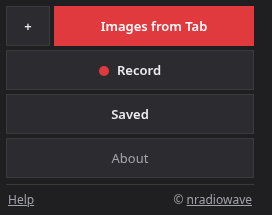
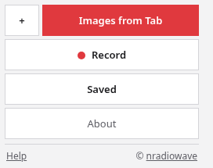
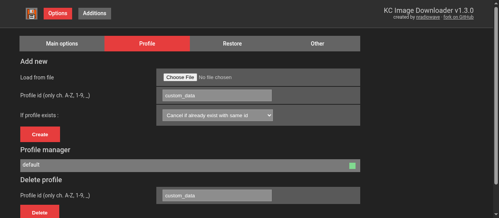

# KC Image Downloader


<p align="center"></p>

A browser extension for Chrome and Firefox that batch-downloads images from any site. You can filter them by size,
proportions or URL. On supported sites it picks the original image instead of the preview.

> [!NOTE]
> This is a maintained fork of KellyC Image Downloader ([NC22/KellyC-Image-Downloader][upstream]) by nradiowave. The original was removed
> from the Chrome, Firefox, Edge and Opera stores and its websites (`kellydownloader.com`, `catface.ru`) are offline.
> There is no store listing for this fork; install it from source or a release zip as shown below.

<p align="center">
  
  
</p>

## Features

- **Grab every image on a tab** – **Images from Tab** opens a downloader page with all images found on the page,
  with filters by width/height, proportions and URL text.
- **Record while you browse** – **Record** keeps collecting images across pages and tabs until you stop. The record
  is kept in extension storage, so it survives the browser suspending the background worker.
- **Several tabs at once** – the **+** button collects from the tabs to the left, to the right, or all tabs.
- **Originals instead of previews** – site filters for Twitter/X, Pixiv, Pinterest, DeviantArt, ArtStation, Reddit,
  Bluesky, Instagram, Flickr, Kemono/Coomer/Pawchive, e-hentai, Hentai Foundry, 9GAG, Discord, VK, Pikabu, Yandex and more
  ([`extension/lib/recorder/filters/`](extension/lib/recorder/filters/)). Sites built with Wix, on any domain, get
  the full-size upload instead of the blurred placeholder or resized copy that the page shows.
- **Load related documents** – when a page only shows thumbnails, the downloader can open the page each thumbnail
  links to and take the full image from there. The request rate is limited in **Options → Main options**.
- **Light and dark theme** – follows the system theme on first run; switch it with the moon button in the bottom
  toolbar.
- **Saved profiles** – keep downloaded-image collections and settings in profiles, with backup and restore.

## Requirements

- Chrome, Chromium, Edge, Brave or Opera **121+**, or Firefox **128+** (ESR or newer).
- To build the zips: `bash` and `zip`. `node` is optional and is only used to syntax-check the scripts.

## Install

### From source (Chrome and other Chromium browsers)

```sh
git clone https://github.com/TheElevatedOne/KC-Image-Downloader.git
```

1. Open `chrome://extensions` and turn on **Developer mode**.
2. Click **Load unpacked** and select the `extension/` folder.

### Firefox

Release and ESR Firefox only install add-ons signed by Mozilla. Installing the plain zip fails with
"This add-on could not be installed because it has not been verified", and `xpinstall.signatures.required` is
ignored there.

- **Signed build (permanent):** download `kc-image-downloader-<version>-firefox.xpi` from the
  [releases][releases] or from the **Build And Release** workflow run, then open it in Firefox (or drag it onto a
  Firefox window).
- **Temporary, for testing:** open `about:debugging#/runtime/this-firefox`, click **Load Temporary Add-on…** and
  select `extension/manifest.json`. Firefox removes it when it restarts.
- **Developer Edition or Nightly:** set `xpinstall.signatures.required` to `false` in `about:config`; then the
  unsigned `-firefox.zip` installs from **about:addons → ⚙ → Install Add-on From File…**.

#### Signing (maintainers)

The workflow signs the Firefox build as an *unlisted* add-on: Mozilla signs it automatically, and it is not listed
on addons.mozilla.org. One-time setup:

1. Sign in at [addons.mozilla.org][amo-keys] and generate API credentials.
2. Add them to the repository as secrets:

   ```sh
   gh secret set AMO_JWT_ISSUER -R TheElevatedOne/KC-Image-Downloader
   gh secret set AMO_JWT_SECRET -R TheElevatedOne/KC-Image-Downloader
   ```

3. Run the workflow (`gh workflow run build-and-release.yml -R TheElevatedOne/KC-Image-Downloader`) or push a
   tag. Mozilla signs each version only once, so bump `version` in `extension/manifest.json` before signing
   again.

### Building

```sh
./build.sh
```

```text
dist/kc-image-downloader-1.3.0-chrome.zip
dist/kc-image-downloader-1.3.0-firefox.zip
```

The script checks that every script in `extension/manifest.json` exists, runs `node --check` on all JavaScript when
Node is installed, and zips `extension/` once per browser. Both browsers use the same Manifest V3 source:
Chrome runs `extension/background.js` as a service worker, and Firefox loads the same files from
`background.scripts`.

The icons are drawn in `extension/env/img/icon.svg` (32, 48 and 128 px) and `icon16.svg` (a simpler 16 px version).
After editing them, run `./icons.sh` (needs `rsvg-convert` from librsvg) to render the PNGs.

## Quick start

1. Open a page with images and click the extension icon.
2. Click **Images from Tab**. A downloader tab opens with the images it found.
3. Narrow the list with the size, proportion and URL filters on the right. On a supported site, the site's
   auto-filter is already on and keeps only the originals.
4. Click **Download** in the side panel to open the download manager, then start the download. Files are saved
   to your browser's download folder; the default subfolder is set in **Options → Other**.

To collect from several pages, click **Record** instead, browse, then open the popup again and click
**Download record**.

## Options

<p align="center"></p>

Open them with **Saved** in the popup or from the browser's extension settings.

| Tab | What it holds |
| --- | --- |
| Main options | bottom toolbar, items per page, request speed for "load related documents" (pause after N requests, pause duration, timeout, threads) |
| Profile | create, switch and delete profiles |
| Restore | export and import a backup |
| Other | dark theme, debug log, mobile layout, Twitter/X tweak, default download folder and request method |

## Adding a site

Most sites only need a URL pattern that marks previews and originals. Sites that hide the original behind a link
need a small filter script. Both are described in
[`extension/lib/recorder/filters/README.md`](extension/lib/recorder/filters/README.md).

## Changes from the original

- Loads again: the manifests listed five joyreactor scripts that upstream had moved to a separate project in 2022.
- One cross-browser Manifest V3 `manifest.json`, no Windows `.bat` merge step; `build.sh` makes the zips.
- Recording no longer loses messages when Chrome wakes the suspended service worker.
- Twitter filter works on `x.com`; Kemono/Coomer filter covers `kemono.cr`, `coomer.st`, `coomer.su` and the
  `pawchive.pw` clone.
- English only: the Russian translation was removed, and Russian messages that were hardcoded in the popup,
  downloader and storage manager are now in English.
- Light theme recoloured to match the dark one, square corners everywhere, system font in the popup, theme
  follows the system on first run.
- Links to the dead project sites point to GitHub; the About page is a short credits page.
- New Wix filter: full-size originals from `static.wixstatic.com` on any Wix site.
- Renamed to KC Image Downloader, with a new icon (a stack of pictures and a download arrow) instead of the floppy disk.

## Reporting problems

Open an issue at [TheElevatedOne/KC-Image-Downloader/issues][issues]. Include the site URL, the browser and
version, and what you expected to be downloaded. For errors, open the downloader tab's developer console
(<kbd>F12</kbd>) and copy any red messages.

## Credits

- **nradiowave** ([NC22][upstream]) – original author of KellyC Image Downloader and all of its site filters.

## License

[GNU General Public License v3](LICENSE).

[upstream]: https://github.com/NC22/KellyC-Image-Downloader
[issues]: https://github.com/TheElevatedOne/KC-Image-Downloader/issues
[amo-keys]: https://addons.mozilla.org/developers/addon/api/key/
[releases]: https://github.com/TheElevatedOne/KC-Image-Downloader/releases
